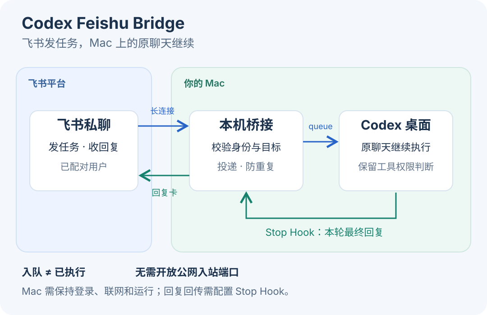

# Codex Feishu Bridge

Continue Codex chats on your Mac from Feishu. Receive replies, images, and questions in a private bot conversation.

[简体中文](README.md) · [Setup](docs/setup.md) · [Usage](docs/usage.md) — detailed guides are in Chinese.



## Features

- **Chat and switch**: send messages to an existing Codex chat with its context intact.
- **Reply notifications**: receive the final response after each turn.
- **Async questions**: answer question cards in Feishu and return answers to the source chat.
- **Images and diagrams**: exchange images and render Mermaid diagrams as images.
- **Chat management**: recent replies, experimental chat creation, and a local pause switch.

Media, questions, and broader reporting scopes are [opt-in](docs/usage.md#功能配置).

## Setup

Requires **macOS, Node.js 24+, Python 3**, a Codex desktop CLI with `queue` support, and a Feishu internal-app bot.

```sh
git clone https://github.com/chenyk2016/codex-feishu-bridge.git
cd codex-feishu-bridge
npm ci
```

Follow the [setup guide](docs/setup.md) to configure Feishu events and card callbacks, initialize the bridge, and pair your private chat. Receiving Codex replies also requires configuring and trusting the Stop hook.

After pairing, send `当前聊天` to check the target, then send your task. Use `切换聊天` to choose another chat.

## Before using

- Designed for one paired user. Your Mac must remain signed in, online, and able to run Codex.
- Feishu answers return to the original chat, but **the desktop question stays open**. Blocking questions and normal tool approvals remain in Codex.
- Enabled reports, questions, and images are sent to Feishu. A queue receipt does not mean the task has completed.

[FAQ](docs/faq.md) · [Compatibility](docs/compatibility.md) · [Architecture](docs/architecture.md) · [Contributing](CONTRIBUTING.md) · [Security](SECURITY.md) · [Changelog](CHANGELOG.md)

Independent community project; not affiliated with OpenAI or Feishu. [MIT License](LICENSE).
