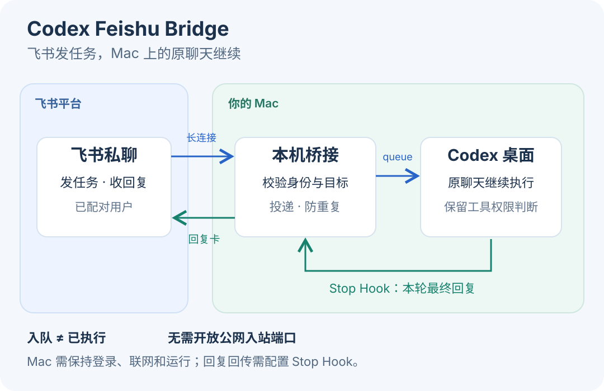

# Codex Feishu Bridge

在飞书私聊里继续 Mac 上的 Codex 聊天，接收任务回复、图片和中途问题。

[English](README.en.md) · [安装指南](docs/setup.md) · [使用与排障](docs/usage.md)



## 功能

- **续聊与切换**：发消息到选定的 Codex 原聊天，保留上下文。
- **回复通知**：一轮结束后，将最终回复发到飞书。
- **异步问答**：中途问题转成卡片，答案回到提问的聊天。
- **图片与图表**：双向收发图片，将 Mermaid 转成图片。
- **聊天管理**：最近回复列表、实验性新建聊天，以及本机暂停开关。

图片、问答和扩大的汇报范围需[单独开启](docs/usage.md#功能配置)。

## 安装

需要 **macOS、Node.js 24+、Python 3**、支持 `queue` 的 Codex 桌面 CLI，以及飞书自建应用机器人。

```sh
git clone https://github.com/chenyk2016/codex-feishu-bridge.git
cd codex-feishu-bridge
npm ci
```

接着按[安装指南](docs/setup.md)配置飞书事件与卡片回调、初始化并配对；接收 Codex 回复还需配置并信任 Stop Hook。

配对后，向机器人发「当前聊天」核对目标，再直接发送任务；发「切换聊天」选择其他聊天。

## 使用前了解

- 面向单个配对用户的私聊，Mac 需要保持登录、联网并能运行 Codex。
- 飞书答案能回到原聊天，但**桌面问题框不会自动关闭**；同步提问和普通工具审批仍在 Codex 处理。
- 汇报、问题和图片会按启用范围发送到飞书；“已加入原聊天”表示入队，不代表任务已完成。

[常见问题](docs/faq.md) · [兼容性](docs/compatibility.md) · [架构](docs/architecture.md) · [贡献](CONTRIBUTING.md) · [安全](SECURITY.md) · [更新日志](CHANGELOG.md)

独立社区项目，与 OpenAI、飞书无官方隶属关系。[MIT License](LICENSE)。
