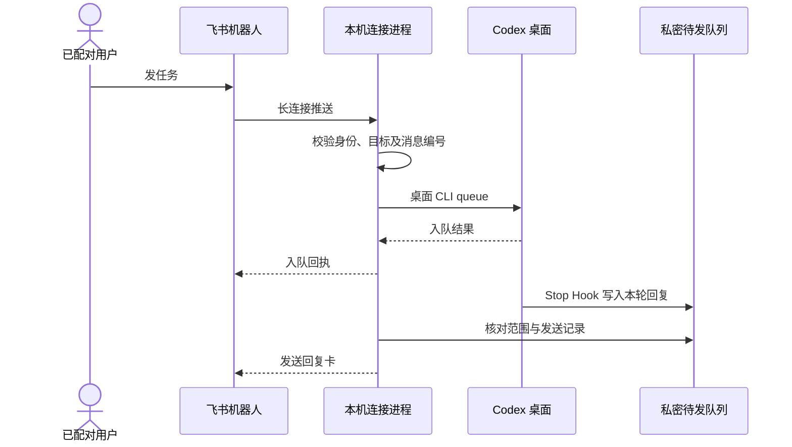

# 架构

飞书负责私聊收发，Codex 桌面负责运行和权限判断。桥接负责单人配对、确定目标聊天、投递以及记录送达结果。

## 从哪里读代码

| 职责 | 入口 |
| --- | --- |
| 安装与运行 | [manage.py](../manage.py)、[service-launcher.py](../src/service-launcher.py) |
| 本机开关 | [settings_server.py](../src/settings_server.py)、[settings.html](../src/settings.html)、[connection_settings.py](../src/connection_settings.py) |
| 飞书连接和配对 | [probe.mjs](../src/probe.mjs)、[probe-core.mjs](../src/probe-core.mjs) |
| 路由和 CLI 入队 | [session-router.mjs](../src/session-router.mjs)、[turn-relay.mjs](../src/turn-relay.mjs) |
| 回复范围与标题 | [report-hook.py](../src/report-hook.py)、[report-scope.mjs](../src/report-scope.mjs)、[chat-metadata.py](../src/chat-metadata.py) |
| 图片与图表 | [incoming-images.mjs](../src/incoming-images.mjs)、[report-media.mjs](../src/report-media.mjs)、[mermaid-renderer.mjs](../src/mermaid-renderer.mjs) |
| 实验性桌面新建 | [chat-management.mjs](../src/chat-management.mjs)、[chat-control.mjs](../src/chat-control.mjs) |

## 状态和恢复

启动器持有进程锁，管理连接进程并提供本机设置页。关闭开关后启动器仍在线，连接进程退出。恢复前写入时间边界，阻断上一次连接的晚到操作和旧待发任务。心跳来自当前连接进程，页上的已连接状态依赖有效心跳和配对。

入站消息先记录去重意图再调用 CLI。命令使用独立参数传递。回传报告经范围校验，以稳定编号和发送回执防重。结果未知的请求不会自动重放。关闭、进程崩溃、权限异常和断网都可能影响最终投递，先查看原聊天和本机回执。

本地元数据查询与消息传输分开。飞书聊天选择会影响后续任务路由，已发卡片保留自己的来源，发送前再次核对已选目标。
