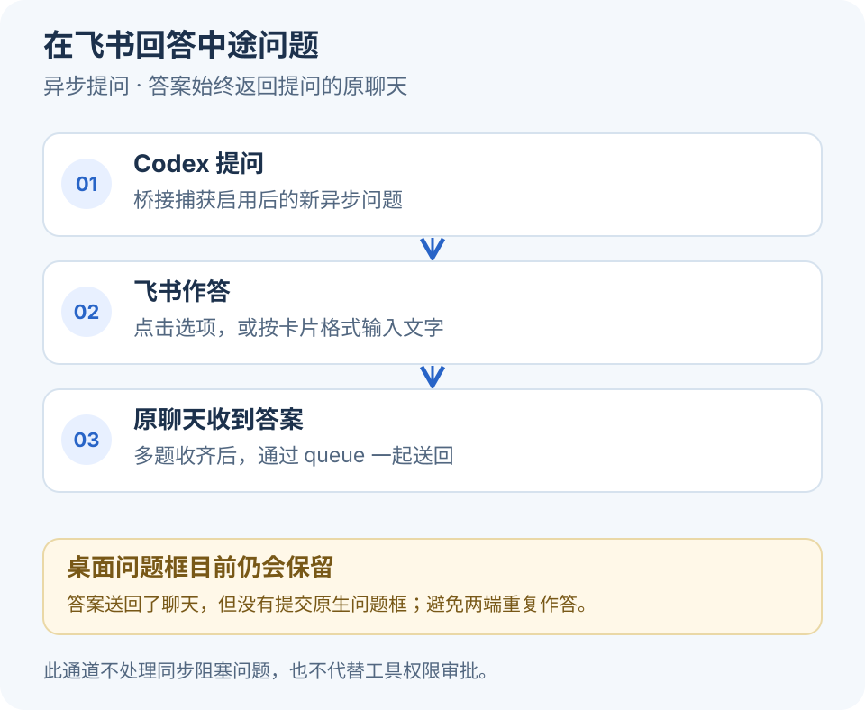

# 常见问题

## Codex Feishu Bridge 是什么？

Codex Feishu Bridge 是一个在 Mac 上运行的社区开源桥接，将已配对用户的飞书机器人私聊连接到现有 Codex 桌面聊天。它负责消息路由、回复卡和可选的异步问题转发；任务执行与工具权限判断仍由 Codex 负责。

## 是 OpenAI 或飞书官方项目吗？

不是。本项目独立维护，与 OpenAI、飞书和字节跳动无官方隶属关系。MIT 许可证覆盖本仓库的项目代码，不授予第三方平台的账号、商标或服务使用权。使用平台服务仍需满足相应条款。

## 飞书回答后，为什么 Codex 的问题框还在？

**当前版本不会自动关闭桌面原生问题框。** 飞书答案作为一条新用户消息加入提出问题的聊天，Codex 可以读取并继续工作；桥接没有提交原生问题表单，也没有把其状态改为“已回答”。这是当前明确的功能边界，不是飞书答案丢失。

不要为了收起界面在两端重复作答。原生状态同步仍是待验证方向。有关有效期、文字回答格式和多题收集的规则见[异步提问使用说明](usage.md#在飞书回答-codex-的中途提问)。

## 所有中途提问都能在飞书回答吗？

不能。当前只处理 `request_user_input_async` 产生的新异步问题，并且要显式开启 `--questions`、配置可用的本机元数据索引。同步阻塞的 `request_user_input` 仍需在桌面回答。此功能不会批准工具权限。

开启后会扫描本机未归档主聊天的新异步问题，范围不只限于全局当前聊天。多题收齐后才提交；每组答案固定回到提出问题的聊天，期间切换其他聊天不会改变答案的去向。

## “已加入原聊天”意味着任务完成了吗？

不意味着。它表示 Codex 消息队列接受了请求。聊天实际开始执行、完成一轮、回复成功发送到飞书，是后续不同的状态。没有看到结果时，先核对正确的原聊天和本机状态，避免重复提交结果未知的任务。

## 点击切换聊天后为什么又出现一张卡片？

这是当前设计。管理卡保留，点击后另发聊天列表，翻页和选中后的确认也另发。这样不依赖原卡片在不同客户端上的原地更新。列表选项有时效，过期后重新发「切换聊天」或点击管理入口。手机端体验仍需按实际飞书版本验证，不能把代码测试当作所有客户端都已验收。

## 支持国际版 Lark 吗？支持 Windows 或 Linux 吗？

当前连接代码使用 Feishu 域，尚未验证国际版 Lark，也没有提供 Lark 域的用户配置开关。依赖名称中含有 Lark 不等于项目支持 Lark。

当前安装器面向 macOS，并使用 macOS 登录服务。Windows 和 Linux 不在当前安装支持范围内，不能只安装 Node.js 就视为可用。

## Mac 休眠、关机或退出 Codex 后还能工作吗？

Mac 休眠、断网、关机或未登录时，不能保持正常收发。登录服务能在用户登录后启动本机连接，不等于能唤醒休眠电脑或远程开机。完整退出 Codex 后自动唤起并确认原聊天消费尚未完成端到端验证。

## 需要公网服务器或开放端口吗？

基础消息流程不需要。飞书事件与卡片回调使用出站长连接；本机设置页仅监听回环地址，供当前 Mac 使用。不要把设置页通过端口转发或隧道暴露到公网。

## 自托管是否意味着聊天内容不会离开设备？

不是。运行进程和私密状态在本机，但启用的最终回复、异步问题与允许发送的媒体会传到飞书。Codex 自身的模型请求还遵循其产品配置和服务条款。请在启用全主聊天汇报、问题扫描或图片前确认对应内容适合传输。详见[安全与数据](../SECURITY.md)。

## 能给团队多人使用或在群里操作吗？

当前面向单个配对用户的机器人私聊。没有团队租户隔离、多人授权、群聊路由或管理员审计产品能力。首次配对可以进一步限定本人在该应用中的 Open ID。

## 是否需要额外购买 API？

桥接使用本机现有 Codex 桌面环境和飞书自建应用，没有要求另配一个模型 API Key。账号资格、模型用量、平台权限及可能的服务费用由对应平台决定；项目不承诺平台免费或无限额度。

## 怎样报告问题？

先核对[使用与排障](usage.md)和[兼容说明](compatibility.md)。提供系统、Node、Codex 和飞书客户端版本、期望行为、实际行为及脱敏最小复现。不要上传真实聊天记录、配对码、凭据或原始数据库。普通问题按[贡献指南](../CONTRIBUTING.md)处理，安全问题按[安全政策](../SECURITY.md)私下报告。
